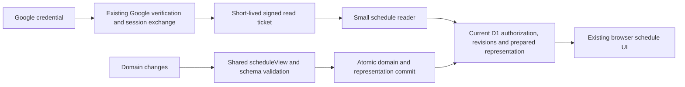

# Schedule reads at or below 9 ms: measured design proposal

Status: proposed architecture, not implemented or deployed. The user requested schedule reads at 9 ms or lower and previously asked that architectural rewrites be proposed before implementation. Work is isolated on `codex/schedule-read-cpu`; application source and production remain unchanged at `55b1a71` / Worker `8e14fcd6-94ac-4a7d-95f0-99ced8df0cbc`.

## Evidence and diagnosis

The [production trial](hot-paths-authenticated-trial.json) captured schedule reads at 17, 5 and 4 ms. A new disposable native workerd/D1 loop used a fixed private backup and synthetic RSA credentials, asserting successful API results. `RUNS=4 MODE=baseline GATE=1 node /tmp/scheduler-schedule-cpu/bench.mjs` exited 1: first-read profile active times were 21.592, 21.678, 16.958 and 16.969 ms. Two repeats per runtime were substantially cheaper. The performance gate asserted that every measured read was at most 9 ms; functional success alone did not pass it.

The harness used Inspector sampling at 100 microseconds and summed non-idle sample deltas. This includes native local D1, profiler and diagnostic wrapper costs. It is a causal local comparison, not Cloudflare CPU accounting, a production bound or a p95/p99 distribution. Multiple fresh runtimes reduce reliance on one isolated sample. Diagnostic inputs, reference responses and profiles stayed private. [All sanitized measurements](schedule-read-design-measurements.json).

Experiments were measured separately, and application changes were reverted:

| Experiment | Fresh runtimes | First-read local profile range, ms | Finding |
| --- | ---: | ---: | --- |
| Current implementation | 4 | 16.958–21.678 | Reproduces the first-use penalty |
| Actual session.me first | 4 | 6.897–7.401 | Shared first-use work is substantial |
| Pure Effect startup initialization | 6 | 14.104–20.624 | Insufficient |
| Synthetic actual dispatch during startup | 6 | 10.062–15.835 | Insufficient; discarded |
| Request-body decoding first | 5 | 11.997–16.299 | Body setup alone does not explain it |
| Actual Google verification first | 6 | 9.551–10.909 | Authentication matters; schedule work also remains |
| Bounded SQL row packing | 6 | 13.751–22.194 | Fewer conversion samples, no adequate end-to-end gain |
| Signed ticket, otherwise existing stack | 6 | 11.646–16.753 | Replacing Google verification alone is insufficient |
| Plain async read, existing Google verification | 6 | 11.712–20.808 | Removing Effect alone is insufficient |
| Minification | 6 | 14.805–20.375 | Insufficient |
| Prebuilt response + ticket, existing shared stack | 8 | 6.642–16.405 | Still lacks first-use headroom |
| Standalone thin reader + ticket + validated prebuilt response | 12 | **4.129–6.216** | Promising combined design |

The standalone prototype's 24 repeat reads measured 1.427–4.085 ms. All 36 measured reads passed its local 9 ms gate. It served the exact 78,467-byte response generated and validated by the existing schedule workflow. It verified actual synthetic HMAC signatures, checked current D1 account activity and administrator role on each request, checked projection revision and SHA-256 integrity, and retained the 64 KiB request-body bound. Negative probes rejected signature tampering, expired tickets, wrong audience/version, deactivated accounts, revoked administrator roles, stale projections and corrupted response bytes. These probes verify the prototype's narrow seam; they do not constitute a production implementation or security review. Its fixed synthetic secret, simplified error handling and one-operation protocol must never be deployed.

## Proposed change

Use a separate, small schedule-read module with three responsibilities:

1. Verify a short-lived application read ticket using native HMAC verification.
2. In one D1 transaction, read current authorization, current revisions and the prepared schedule representation.
3. Verify representation integrity/version, attach current metadata and return the prepared bytes.

The reader should not import the scheduling engine, Temporal, generic Effect dispatch, Google JWKS machinery or full response-schema traversal. Schema validation remains authoritative when preparing the representation, and client response validation remains. This is an explicit change to validation ownership, not permission to omit validation or accept corrupt responses.

### Authentication contract

Google signature, issuer, audience, expiration and verified-email checks stay at the exchange boundary. Ticket expiry must be no later than the verified Google token expiry, with an additional short maximum lifetime. Bind the ticket to the application, environment, issuer, protocol version and read purpose. Use a dedicated random secret supplied through Worker secrets; never reuse an email-provider key. Verify signatures with native constant-time cryptographic APIs. Bound token size and reject malformed claims and unsupported versions before granting access.

Keep both credentials in browser memory only: the Google credential continues serving existing operations; the read ticket serves only schedule reads. Every read still checks current D1 activity and roles, so the same ticket stops working immediately after revocation or deactivation. No server cache of users, roles or verified identities is introduced. Expired tickets require a valid exchange or reauthentication; they must not extend the Google authorization lifetime. Secret rotation needs a bounded, explicitly reviewed overlap policy.

Bind production tickets to the authenticated account ID as well as normalized email, and require both to match the active D1 account. This prevents an old ticket from following an email address to a replacement account. The prototype checked normalized email only; that simplification is not the proposed production contract. Signing must use the identity/expiry produced by successful Google verification, never caller-supplied claims. Keep the current operation-policy rule authoritative; importing that rule into the small reader must not pull in the generic runtime.

The small reader still needs strict guards for its envelope, claims and account projection, with typed application failures. In particular, parsed `roles` must be an array of valid roles, not any value with an `includes` method; the performance prototype's compact role check is insufficient for corrupted stored values. Add malformed stored-role, missing-account, replaced-account-ID and malformed ticket-claim cases to the implementation's native rejection tests. Smaller dependencies must not weaken these boundaries.

The exchange's own production CPU is a separate release gate under the broader Workers Free constraint. Prototype it before building the full design. A schedule read must not fall back to expensive Google verification when a ticket is absent; protocol cutover and old-client recovery need an explicit client flow. Keeping an over-budget legacy schedule path permanently would not meet the objective.

### Schedule consistency contract

Add an internal materialized representation, prepared using the existing shared `scheduleView` and response-schema rules. This retains the same greatest-completed-output selection, assignment/backup filtering, ordering, legacy shortfall normalization and public response fields. Do not create an independent SQL implementation of publication rules.

The representation must be maintained for changes to volunteers, sessions, scheduling runs, assignments and backups, including publication, cancellation/promotion and relevant synchronization changes. Preparation may need its own bounded Queue stage; do not append it to an existing stage without measuring CPU. Commit domain changes and their prepared representation atomically under existing revision/actor fences. Concurrent human edits must invalidate preparation and retry before commit. No completed write may expose a stale representation.

#### Current write-path audit

Tracing every current mutating operation narrows the implementation. The core representation is `scheduleView` without `stale`, plus separate current revision metadata. That shared rule reads only volunteers, sessions, scheduling runs, assignments and backups. The current WhenIsGood applicator changes recurring availability and provenance, not volunteer records or published commitments. Therefore current synchronization does **not** need to regenerate the core representation or acquire the full schedule snapshot. It must still advance the appropriate live metadata, so the next read immediately reports `stale` when availability changed.

| Current operation/path | Core response change | Live metadata / required action |
| --- | --- | --- |
| admin.schedule.rerun | New run, assignments, backups and shortfalls | Prepare core and commit atomically with publication |
| volunteer.assignment.cancel | Cancellation, promoted assignment, backup order/status, run IDs and shortfalls | Prepare core and commit atomically with cancellation; refresh revisions and stale state |
| admin.center.candidate.confirm | Adds a dated session | Prepare core and commit atomically with confirmation; refresh revisions and stale state |
| volunteer.availability.recurring.update | None | Read current revisions and derive stale state |
| volunteer.availability.exception.create | None | Read current revisions and derive stale state |
| admin.sync.now and scheduled source application | None with current applicator | Preserve cheap Queue paths; read current revisions and derive stale state |
| admin.import.whenIsGood.promote | None | Availability/provenance changes only; refresh metadata |
| admin.import.mapping.upsert | None | Mapping plus possible availability/provenance/status changes; refresh metadata |
| admin.import.whenIsGood.preview | None | History only; refresh data revision |
| center.candidate.update | None | Proposal only; refresh data revision |
| Idempotent replay of any write | None beyond the original commit | Do not regenerate or overwrite the representation on replay |

This follows the current handlers in `src/worker/api/handlers/{schedule,volunteer,candidates,imports}.ts`, `src/worker/importAvailability.ts`, `src/worker/synchronization.ts`, and the transactional diff/revision owner `src/worker/repositories/database.ts`. It is a source-level audit, not proof of a future implementation. Existing public-workflow checks exercise publication, cancellation/backup promotion, candidate confirmation and synchronization preservation; materialized-read integration coverage remains to be written after approval.

The audit reran `npx vitest run test/integration/workflows.test.ts test/integration/synchronization.test.ts` with native local D1: **130 tests passed across both files**. This verifies the existing workflows the design must preserve; it does not test the unimplemented representation writer or establish production CPU performance. No application code changed during the audit.

Use actual changed tables, not a permanent hardcoded operation allowlist, to detect representation-affecting commits. Otherwise a future volunteer edit endpoint or a synchronization enhancement could silently miss invalidation. The current operation matrix explains present costs; it does not replace a shared table-level dependency declaration. Also cover controlled roster/session maintenance outside HTTP: it must update the representation transactionally or explicitly invalidate it and rebuild before enabling reads. Returning a stale representation after a direct database change is unacceptable. Missing/invalidated representations must fail explicitly, and the normal maintenance procedure must avoid leaving users in that state.

Cancellation also creates a dated availability exception and mutates the selected scheduling run, so it cannot be treated as an assignment-only patch. Candidate confirmation changes `sessions` even though its main response is a candidate. The serialized `run` includes its original assignment/backup ID lists, timestamps and diagnostics; preserve those fields as returned by the shared rule rather than reconstructing a smaller run summary.

Keep current `dataRevision`, `schedulingInputRevision` and derived `stale` metadata separate from the immutable prepared fields. Read them transactionally with the representation and current authorization. This avoids rewriting the full response for unrelated changes while preserving the current expected-revision contract. Version the representation and its inputs explicitly; do not rely on a wall-clock cache TTL.

Store large representations in bounded chunks instead of introducing a new whole-table/cell size limit. Preserve JSON escaping through the canonical serializer; never interpolate raw user fields into response text. Store an integrity digest at preparation and verify it before use. Corrupt, missing or inconsistent data must produce a typed error without exposing a stale schedule or silently using the old slow path. A write-through invariant and pre-cutover backfill are therefore required for normal reads to remain available.

### Release and rollback

This requires implementation approval first. After implementation and review, production actions require separate, concrete approval: add the read-ticket secret, apply an additive representation migration/backfill, and deploy the exact candidate. Do not run these actions from this proposal.

Develop writer support before enabling the new reader; backfill and verify a consistent representation before cutover. Cover old-client recovery, ticket expiry and key rotation without background browser polling. Preserve the existing visible schedule and explicit Reload view behavior.

Rollback must restore the existing reader and client while retaining the additive representation table. Old Writer versions will not maintain the new representation; any later reactivation must backfill and verify it again. Code rollback never restores database contents. Keep the present deployed version and the existing Queue bindings available.

## Required proof before completion

- Public-workflow tests for Google exchange failures, expiry bounds, purpose/audience isolation, invalid signatures, role revocation/deactivation and unchanged behavior of other operations.
- Native D1/browser tests for identical schedule responses; stale status after input changes; publication, cancellation and backup promotion; relevant import/volunteer changes; empty schedules; equal-clock/output ties; legacy data; corrupt/missing representations; large chunked responses; concurrent writes; and atomic rollback on commit failure.
- Final functional/browser checks, typechecks, builds and tracked/private dry runs against the corrected candidate.
- Production operation-attributed CPU at **9 ms or lower**, including first requests in fresh runtimes, repeated reads and representative largest supported schedules. Also check the exchange and added preparation stages against the broader Free-plan budget. Successful HTTP responses do not prove CPU fit.

The current goal remains active and unachieved. The standalone prototype establishes a direction with local headroom; it does not prove deployed performance or writer consistency. No production mutation, deployment, new secret, new session protocol or storage migration was performed during this investigation. Throwaway drivers, generated bundles, raw reference responses and profiles were removed after saving the sanitized evidence; the operator's backup remains untouched.
