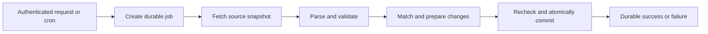

# Worker CPU strategy — proposal, October 16, 2026

## Recommendation

Split synchronization into durable, independently budgeted invocations before considering a full language or framework rewrite. The clearest design uses Cloudflare Queues with **one stage per consumer invocation** and a D1 job record. Workflows is a candidate alternative, subject to verifying its budget enforcement: the limits table says 10 ms compute per Free step, while pricing says 10 ms per invocation and explicitly says steps are not invocations. Do not infer a guaranteed budget reset from those differently worded pages alone. This is a proposed architectural change, not an implemented migration. The operator requested that architectural rewrites be suggested before implementation.

The objective is dependable per-invocation CPU headroom, including first use and changed input. Target roughly 6–7 ms per stage on Cloudflare, rather than treating a local mean just below 10 ms as sufficient. Splitting can increase total CPU, storage operations and latency while reducing the maximum CPU consumed by any one invocation.

## Evidence and current state

Production application `2d6ae01`, Worker version `48b0aa83-44eb-4007-a9c4-75c237e9f372`, remains above budget. Its two approved manual checks used 27 and 11 ms; an observed scheduled check used 16 ms. Subsequent sync reads used 5 and 6 ms. All succeeded, preserving domain/scheduling revisions 1/1 and import history. These are a few observations, not a cold/warm distribution. Details are in [the release record](../releases/6-synchronization.md).

The unshipped follow-on candidate removes duplicate interval validation/allocation and persists a parser-version/timezone/content fingerprint. It still fetches and bounds the source and reads current users/revisions on every check. Source changes, domain edits or a different parser version invalidate reuse. The fingerprint commits atomically with the corresponding synchronization result; no migration is needed.

Temporary local comparisons used actual Worker entry points, disposable D1, RSA authentication and fixed private source input. With 100 warm-ups and 500 measured invocations, whole-workerd CPU means were:

| Version | Scheduled (ms) | Manual sync (ms) |
| --- | ---: | ---: |
| Deployed source | 7.24 | 7.58 |
| Interval allocation changes | 6.76 | 7.02 |
| Fingerprint plus interval changes | 5.52 | 6.92 |
| Same candidate, minified | 5.58 | 6.62 |

These include local D1 and a diagnostic wrapper, exclude the Node driver, and have 10 ms OS counter resolution aggregated over the batch. Variation between runs prevents attributing small differences confidently. They do not establish deployed per-event compliance.

A separate fixed-source Node parser comparison asserted identical complete parsed output and reduced warm CPU from about 1.01 to 0.60 ms per parse. This matters on changed input; fingerprint hits skip that parsing entirely.

The current warm inspector profile points to bounded body consumption, native request/stream handling and D1 response conversion as substantial remaining costs. For scheduled checks, sampled self time included about 0.88 ms in `readBoundedText`, 0.49 ms in native stream reads, 0.41 ms in D1 `toJson`, 0.24 ms in Effect's `runLoop`, and 0.19 ms in hashing. These are sampled self times with profiler overhead, not additive architectural speedup promises. Native/unnamed frames prevent a complete attribution of the remainder. A native `TransformStream` plus `Response.text()` experiment increased local means to 6.32/7.42 ms and was discarded.

## Proposed durable synchronization module

Keep one domain interface: start a synchronization intent and observe its durable result. HTTP and scheduled adapters use it with different authority. Internally, use separately measured steps:

1. **Start:** Verify Google credentials and current administrator authority for manual jobs. Use the existing system authority only from the scheduled adapter. Persist/reuse an intent keyed by actor, operation and idempotency key; scheduled time supplies the scheduled key. Return a job reference promptly. The UI distinguishes queued/running checks from completed success; a bounded completion check follows the explicit action rather than adding periodic polling to every open view.
2. **Fetch:** Fetch and size-bound one source snapshot. Persist that exact input for subsequent stages and retries so one job cannot combine different source versions. Queue messages carry a small job reference, rather than the raw source: their 128 KB maximum is below the app's 2 MiB source cap. Persist private source in bounded D1 chunks or a separately reviewed blob store. If using Workflows instead, non-stream results have a 1 MiB limit; supported streamed results are an alternative.
3. **Parse:** Parse/validate that fixed source and compute its fingerprint. Keep global completeness and participant-identity checks. If this step exceeds the target on larger supported input, chunk along validated participant records with a final completeness check; do not split arbitrary HTML bytes or silently lower the input limit.
4. **Prepare:** Read an internally consistent domain snapshot, resolve identities and calculate the proposed change set. Retain the domain revision and synchronization generation used for that calculation. Large rosters may need bounded preparation chunks, with global matching ambiguity resolved consistently.
5. **Commit:** Recheck manual actor authority, revision and generation. A newer completed check supersedes an older job. A conflicting human write causes bounded recalculation from fresh domain state using the same source snapshot. Commit domain changes, provenance/history, revisions, status, source fingerprint and durable result in one D1 transaction. A redelivery must find the committed intent and produce the same result without duplicate history.

The fetch/parse stages may be combined if their measured cold and changed-input CPU has adequate margin. Four processing stages at 48 scheduled checks/day mean approximately 192 message deliveries and 576 Queue operations/day before retries and manual checks, compared with 10,000 included Free operations/day. If Workflows enforcement is verified, four steps would use about 192 of its 3,000 Free daily steps before retries and manual checks. These are projections, not measured usage; storage, request and D1 row allowances still apply.

Keep the next-stage intent in the same D1 transaction as each completed stage, using an outbox. Sending a Queue message and committing D1 cannot be assumed atomic: retry unsent outbox entries, and acknowledge a delivered message only after its stage's durable state commits. Scheduled recovery must remain bounded too. Use deterministic stage keys and generation/revision fences to make duplicate delivery harmless. Queue delivery is at least once; it does not provide exactly-once domain writes.

Workflows would provide checkpointing and retries but would not replace the application's atomic D1 commit or its authorization, revision and generation fences. Store only required private intermediate state; application history remains in D1 rather than depending on Queues' 24-hour Free message retention or Workflows' three-day Free completed-state retention.

## Other strategies

| Strategy | Assessment |
| --- | --- |
| Independent HTTP requests | Each real HTTP invocation has its own budget. A caller can submit staged work, but browser-driven continuation cannot provide unattended 30-minute synchronization or reliable retries. Persisted continuation and server-side delivery are still needed. |
| Queue stages | Leading option with explicit durable job state and an outbox. Configure one work item per consumer invocation: several messages processed in one batch share that invocation's work budget. Requires orchestration, deduplication and failure recovery. Queues Free includes 10,000 operations/day; operations include message writes, reads and deletes, not just logical jobs. |
| Workflow steps | Potentially simpler durable orchestration. The limits page explicitly lists 10 ms compute per Free step, but pricing labels CPU per invocation and says steps are not invocations. Validate actual enforcement on a disposable deployed experiment before choosing this as a budget-reset mechanism. |
| Service bindings / RPC | Useful for internal isolation and independent deployment. A method call, `await`, `Promise.all` or `waitUntil` alone is not evidence of a fresh CPU budget. Current pricing aggregates CPU across a service-binding chain; that billing rule does not by itself establish its limit-enforcement semantics. Do not select this design as a CPU-budget reset without a deployed enforcement test. |
| Focused SQL commands and projections | Strong next option if a stage still exceeds budget. Replace broad snapshot/diff work inside a deep persistence module with operation-specific reads and transactional commands. Preserve concurrency and audit behavior through the existing public workflow tests. Database query wait time is excluded from Worker CPU, but JavaScript encoding and decoding still count. |
| Plain async TypeScript and precompiled validation | Credible rewrite candidate if framework/schema costs dominate measured cold paths. Keep shared pure domain rules and persistence invariants, use native async orchestration and build-generated validators instead of generic runtime interpretation. Benchmark a representative complete operation before proposing migration across all handlers. Bundle size alone does not prove request CPU savings. This rewrite has not been implemented. |
| Rust / WebAssembly | Consider for a remaining measured compute-heavy kernel such as large matching/scheduling work. It does not eliminate JWT checks, host D1 calls, JSON conversion or stage orchestration. Include JS/Wasm transfer, allocation and cold initialization in comparisons and validate identical results. A full Rust rewrite is not justified by the current profile. |
| Minification | Useful bundle reduction, weak measured request-CPU benefit here. Local esbuild output fell from 1,106,625 to 577,484 bytes with names retained. Without names: 1,023,858 to 537,815 bytes. Effect contributes about 665 KB before minification and 298 KB after; Temporal about 184/131 KB. These are bundle contributions, not CPU attribution. No minification setting has been changed. |

## Decision gate

Before implementing the architecture, obtain operator agreement to the durable-job behavior, job/outbox schema and new Queue resource/configuration. If testing Workflows instead, separately review the disposable deployment needed to establish enforcement. Before deploying the architecture, complete a concrete migration and rollback plan and obtain the separate production approval required by README. The current local candidate is retained as an independently reviewable fallback; it has not been deployed and the CPU goal remains open.

Verification must cover first use, unchanged and changed source, malformed/oversized input, stale human edits, role revocation, overlapping jobs finishing out of order, failure between preparation and commit, and redelivery after commit. Measure each actual deployed stage's CPU and the end-to-end result, with margin under 10 ms. Measure cold authenticated reads/start requests too: splitting synchronization does not automatically fix their separate CPU costs.

## Primary sources checked October 16, 2026

- [Workers limits](https://developers.cloudflare.com/workers/platform/limits/): 10 ms per Free HTTP request/Cron Trigger; network/database waiting excluded from CPU.
- [Workflows limits](https://developers.cloudflare.com/workflows/reference/limits/): 10 ms compute per Free step, 1 MiB non-stream step results, streamed results, and completed-state retention.
- [Workflows pricing](https://developers.cloudflare.com/workflows/reference/pricing/): Free request, CPU, step and storage allowances.
- [Queues pricing](https://developers.cloudflare.com/queues/platform/pricing/) and [consumer limits](https://developers.cloudflare.com/queues/platform/limits/): delivery operation accounting, batches and invocation limits. The consumer page's 30-second default prose is not evidence of a Free-plan exemption from Worker CPU limits.
- [Service bindings](https://developers.cloudflare.com/workers/runtime-apis/bindings/service-bindings/) and [Workers pricing](https://developers.cloudflare.com/workers/platform/pricing/#service-bindings): internal calls and combined billing; no claimed enforcement reset from this alone.
- [WebAssembly](https://developers.cloudflare.com/workers/runtime-apis/webassembly/) and [Rust support](https://developers.cloudflare.com/workers/languages/rust/): supported language/runtime options and binary-size/startup tradeoffs.
- [Wrangler configuration](https://developers.cloudflare.com/workers/wrangler/configuration/#top-level-only-keys): minification and name retention.
- [CPU profiling](https://developers.cloudflare.com/workers/observability/dev-tools/cpu-usage/) and [production profiling](https://developers.cloudflare.com/workers/observability/profiling-in-production/): local/production measurement limitations and supported capture paths.
